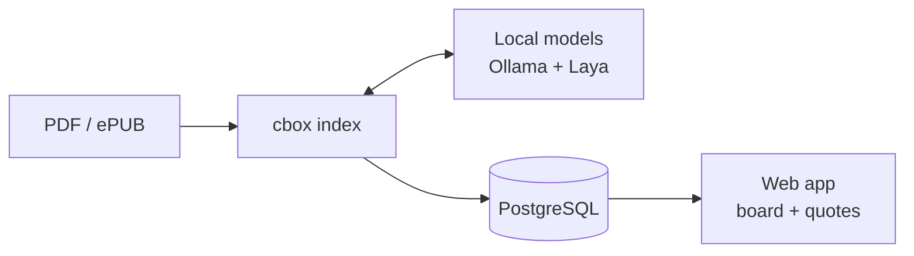

# ChessBox Informant

Find what your chess books say about the position on the board.

ChessBox Informant indexes the chess books you own (PDF or ePUB) and links every annotated move, variation and commentary passage to the exact position it talks about. Play or set up a position in the web app, and the side panel shows the matching quotes along with the book, chapter and page.

Everything runs locally. Indexing uses a generative LLM served by [Ollama](https://ollama.com) and [Laya](https://huggingface.co/convaiinnovations/laya), a small System One decision model. Your books never leave your machine.

> **Status: pre-alpha.** The board UI and the CLI skeleton exist; indexing is not implemented yet. See the [milestones](docs/milestones.md).

## How it works

1. `cbox index my-book.epub` extracts the text, finds chess notation, and uses local models to work out which comments belong to which moves.
2. Every move is replayed with a chess rules engine, so each quote is stored against a verified position.
3. The web app looks up quotes for the current position after every move. Lookups go by position, not move order, so transpositions are found too.



## Requirements (planned)

| Tool | Purpose |
|---|---|
| Go 1.26+ | `cbox` CLI |
| Bun 1.4+ | Web app |
| Docker | PostgreSQL |
| Ollama | Generative LLM |
| Python 3.10+ | Laya (optional: `--no-triage` skips it) |
| GPU | An NVIDIA card with 8 GB VRAM is the target. CPU works, but slowly. |

## Development

```bash
docker compose up -d postgres            # PostgreSQL on localhost:5433
cd backend && go run . --version         # CLI
cd frontend && bun install && bun dev    # http://localhost:3000
```

## Planned usage

```bash
ollama pull qwen3.5:9b
pip install "laya[serve]"

cbox migrate
cbox doctor
cbox index ~/books/my-system.epub
cbox books list
```

## Documentation

- [Architecture](docs/architecture.md): components, data model, API, position keys, technical decisions
- [Indexing pipeline](docs/indexing.md): stages, model roles, the 8 GB VRAM budget, evaluation
- [Milestones](docs/milestones.md): roadmap and acceptance criteria

## Your books, your quotes

ChessBox Informant does not ship or download any book content. Index only books you own. The database stores excerpts of them, so keep it for personal use.

## License

[MIT](LICENSE)
