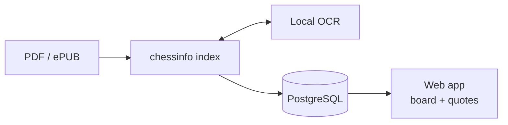

# ChessBox Informant

Find what your chess books say about the position on the board.

ChessBox Informant indexes the chess books you own (PDF or ePUB) and links every annotated move, variation and commentary passage to the exact position it talks about. Play or set up a position in the web app, and the side panel shows the matching quotes along with the book, chapter and page.

Everything runs locally, and indexing is deterministic: chessinfo reads PDFs with its own local OCR, finds the chess notation, and replays every move with a chess rules engine. No LLM is involved. Your books never leave your machine.

> **Status: pre-alpha.** The board UI and the CLI skeleton exist; indexing is not implemented yet. See the [milestones](docs/milestones.md).

## How it works

1. `chessinfo index my-book.epub` extracts the text (reading PDFs with its own OCR), finds chess notation, and builds each game's move tree.
2. Every move is replayed with a chess rules engine, so each quote is stored against a verified position.
3. The web app looks up quotes for the current position after every move. Lookups go by position, not move order, so transpositions are found too.



## Requirements (planned)

| Tool | Purpose |
|---|---|
| Go 1.26+ | `chessinfo` CLI |
| Bun 1.4+ | Web app |
| Docker | PostgreSQL |
| Poppler | PDF text extraction and page rendering (`pdftotext`, `pdftohtml`, `pdftoppm`). Windows: `winget install oschwartz10612.Poppler`; macOS: `brew install poppler`; Debian/Ubuntu: `apt install poppler-utils`. The xpdf `pdftotext` that ships with Git for Windows does not work; use `--poppler-dir` if it comes first on your PATH. |
| OCR engine | Chosen in M4; runs on CPU. A GPU with up to 8 GB VRAM may speed it up. |

## Development

```bash
docker compose up -d postgres            # PostgreSQL on localhost:5433
cd backend && go run . --version         # CLI
cd backend && go run . migrate           # apply database migrations
cd backend && go run . index <file> --dry-run   # show how a book is extracted and chunked
cd backend && go test ./...              # backend tests; set CHESSINFO_TEST_DATABASE_URL to include DB tests, CHESSINFO_TEST_OLLAMA_URL (and optionally CHESSINFO_TEST_LLM_MODEL, CHESSINFO_TEST_SYSTEMONE_MODEL) to include live Ollama tests
cd frontend && bun install && bun dev    # http://localhost:3000
```

## Planned usage

```bash
chessinfo migrate
chessinfo doctor
chessinfo index ~/books/my-system.epub
chessinfo books list
```

## Documentation

- [Architecture](docs/architecture.md): components, data model, API, position keys, technical decisions
- [Indexing pipeline](docs/indexing.md): stages, OCR, evaluation, and the measurements that led to a pipeline without models
- [Milestones](docs/milestones.md): roadmap and acceptance criteria

## Your books, your quotes

ChessBox Informant does not ship or download any book content. Index only books you own. The database stores excerpts of them, so keep it for personal use.

## License

[MIT](LICENSE)
