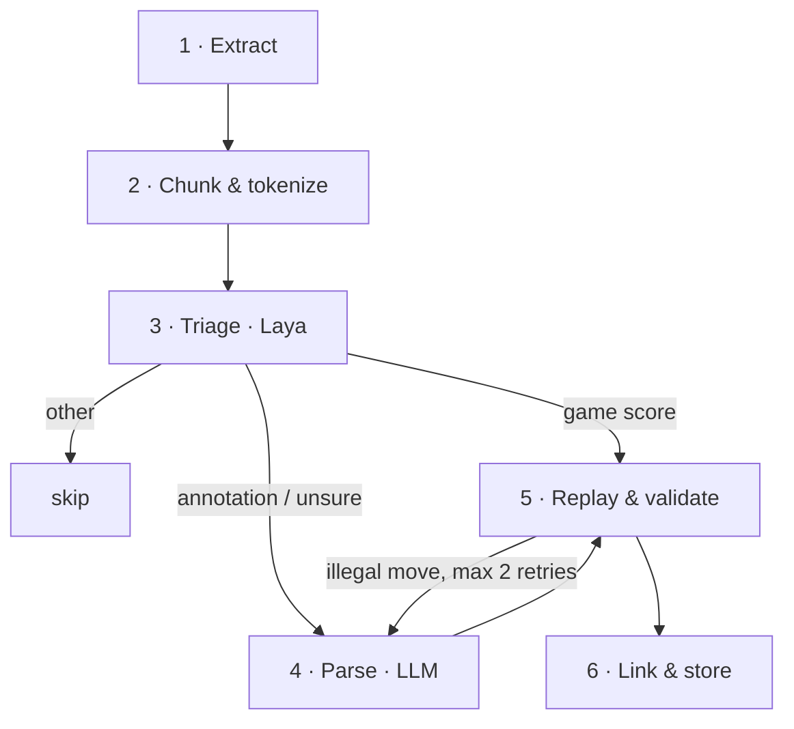

# Indexing pipeline

`chessinfo index <file>` turns a book into rows in `quotes` and `quote_positions` (see the [data model](architecture.md#data-model)). Each stage saves its output per chunk, so an interrupted run resumes where it stopped. A book is identified by the SHA-256 of its file, so re-indexing an unchanged book does nothing.



The guiding rule: **models classify and link, deterministic code handles chess.** The LLM never writes a move. It refers to move tokens that the tokenizer already found, and every move is replayed with a chess rules library before it is stored.

## 1. Extract

- **ePUB:** read the spine in order and convert the XHTML to text blocks. Chapter titles come from the navigation document. Title, author and language come from the OPF metadata.
- **PDF:** take the text layer page by page (`pdftotext -layout`). Remove running headers and footers (lines repeated across pages), join hyphenated words, and fix ligatures. A PDF without a text layer is rejected with a clear message; OCR is out of scope until M7.
- `--title`, `--author` and `--language` override the detected metadata.

## 2. Chunk & tokenize

**Chunking.** Split the text into paragraph-sized chunks that never cross a chapter boundary, and keep the chapter and page with each chunk.

**Notation convention.** Detect it once per book, from these candidates:

| Convention | King | Queen | Rook | Bishop | Knight |
|---|---|---|---|---|---|
| English | K | Q | R | B | N |
| Portuguese | R | D | T | B | C |
| Spanish | R | D | T | A | C |
| German | K | D | T | L | S |
| French | R | D | T | F | C |
| Figurine | ♔ ♚ | ♕ ♛ | ♖ ♜ | ♗ ♝ | ♘ ♞ |

The letters overlap: `R` means rook in English but king in Portuguese, Spanish and French. For that reason, detection replays the first move tokens of the book under each candidate convention and picks the one that produces the most legal moves. The result is stored in `books.notation` and can be overridden with `--notation`. Descriptive notation (`P-K4`) is planned for M7.

**Tokenizing.** Find move candidates (`23.Nf5!`, `23...gxf5`, `O-O`, `exd8=Q+`) and give each an ID. The LLM sees the IDs inline:

```
Text:   23.Nf5! A move that changes everything. 23...gxf5 (23...Qd7 24.Nh6+ Kh8 25.Qg4 and Black is lost) 24.Qg3+ Kh8 25.Qh4 The point: h7 cannot be defended.

Tokens: [m1 23.Nf5!] A move that changes everything. [m2 23...gxf5] ([m3 23...Qd7] [m4 24.Nh6+] [m5 Kh8] [m6 25.Qg4] and Black is lost) [m7 24.Qg3+] [m8 Kh8] [m9 25.Qh4] The point: h7 cannot be defended.
```

## 3. Triage (Laya)

[Laya](https://huggingface.co/convaiinnovations/laya) is a System One decision model: a 421M-parameter ModernBERT classifier (Apache-2.0). It does not generate text. It answers typed questions (`choice`, `noul` = P(true), `score`) about a state in a single forward pass. This makes it a cheap way to decide which chunks need the expensive LLM.

Request sent to `POST /v1/systemone`:

```json
{
    "model": "laya",
    "state": {
        "previous": "…last ~60 words of the previous chunk…",
        "passage": "…chunk text…"
    },
    "questions": {
        "kind": {
            "type": "choice",
            "instructions": "What kind of chess book passage is this?",
            "criteria": {
                "game_score": "Moves of a game with little or no commentary",
                "annotation": "Commentary on specific moves or variations",
                "discussion": "Prose about a position or plan, without moves",
                "other": "Preface, biography, index, bibliography or other non-chess text"
            }
        },
        "discusses_previous": {
            "type": "noul",
            "instructions": "Does the passage talk about the position or moves that came right before it?"
        },
        "instructive": {
            "type": "score",
            "instructions": "How useful is this passage as a quote shown next to the position?",
            "criteria": ["Not useful", "Marginal", "Useful", "Very instructive"]
        }
    }
}
```

Routing, where τ is a confidence threshold:

| Laya answer | Action |
|---|---|
| `other`, confidence ≥ τ | Skip. No LLM call. |
| `game_score`, confidence ≥ τ | Parse deterministically, without the LLM. Fall back to the LLM if the parse or replay fails. |
| `annotation` | Parse with the LLM. |
| `discussion`, and `discusses_previous` ≥ τ | Store the whole chunk as a `discussion` quote on the last position reached. |
| `discussion` otherwise | Skip. |
| Confidence below τ | Parse with the LLM. |

`instructive` becomes the quote's `relevancy` (the score divided by 3), which ranks the quotes in the panel.

**Constraints:**

- **Context window.** The English checkpoint has a 512-token window, so state is capped at about 350 tokens. Longer chunks are triaged in windows, and the most expensive outcome wins (annotation > game score > discussion > other). For books not in English, `laya-multilingual` is used (1,024 tokens by default).
- **Thresholds.** Laya's `confidence` measures how concentrated its answer is, not whether it is correct, and the model is over-confident as shipped. τ starts conservatively at 0.8 and is tuned against labeled fixtures in M6.
- **Options.** Answer options share a small token budget, so keep them few and short.
- **Opting out.** Without triage (`--no-triage`, or when Laya is not pulled), every chunk that contains move tokens goes to the LLM. Triage is an optimization; the pipeline must work without it.

**Where Laya is not used:** parsing moves (it cannot generate output), detecting the notation convention (replay is more reliable), and anything that needs more than ~350 tokens of context at once.

## 4. Parse (LLM)

The LLM is called through Ollama `/api/chat`, with a JSON schema in `format` and `temperature: 0`. It receives:

- the running context: the current game header, the last mainline move and the side to move
- the tokenized chunk

It must return output in this shape:

```json
{
    "game": null,
    "mainline": ["m1", "m2", "m7", "m8", "m9"],
    "variations": [
        { "replaces": "m2", "moves": ["m3", "m4", "m5", "m6"] }
    ],
    "comments": [
        { "after": "m1", "text": "A move that changes everything." },
        { "after": "m6", "text": "and Black is lost" },
        { "after": "m9", "text": "The point: h7 cannot be defended." }
    ]
}
```

- `game` holds `{ white, black, event, year, result }` when a new game or example starts in this chunk; otherwise the running game continues.
- `after` anchors a comment to the position after that move.

Output is rejected, and the chunk retried, if any of these checks fail:

- A token ID is unknown or used twice.
- A comment's `text` is not a verbatim substring of the chunk (after whitespace normalization).
- The output does not validate against the schema.

## 5. Replay & validate

- Replay the mainline from the running position. Each variation branches from the position before the move it replaces.
- Compare the move numbers printed in the tokens with the computed ply. A mismatch means the structure is wrong.
- When a move is illegal, re-prompt with the exact error, for example: ``m7 `24.Qg3+` is illegal after 23.Nf5 gxf5``. After 2 failed retries, the chunk is marked `failed` with the reason, and the pipeline moves on. Later chunks of the same game continue from the last good position until the move numbers stop lining up or a new game starts.
- `chessinfo books show <id>` lists the failed chunks.

## 6. Link & store

A quote is everything the book says about one position, the **quoted position**. It has three parts:

- its prose (`content`)
- the **main variation**: the main-line moves that follow it (`main_variation`, returned by the API as `mainVariation`)
- the sidelines the book gives from there (`analysis`, returned by the API as `moveAnalysis`)

The quote is built in four steps:

1. Every main-line position with a comment anchored after it becomes a quoted position, and that comment becomes the quote's `content`.
2. The main variation runs from the quoted position up to the next quoted position in the same game, or to the end of the game.
3. Each variation is added as an analysis line to the quote of the position it branches from. If that position has no comment, a quote with empty `content` is created for it. A comment anchored inside a variation becomes that line's `comment`, not a quote of its own.
4. Links are created:
   - The quoted position gets an `exact` link.
   - Every position the main variation reaches after *n* half-moves gets a `main` link with `ply = n`. The last position is skipped, because it is the next quote's `exact` position.
   - Every position reached inside line *i* after *n* half-moves gets an `analysis` link with `line = i` and `ply = n`.

For the example in stage 4:

| Quote | Quoted position | `content` | Main variation | Analysis lines |
|---|---|---|---|---|
| 1 | after `23.Nf5` | A move that changes everything. | `23...gxf5 24.Qg3+ Kh8 25.Qh4` | `23...Qd7 24.Nh6+ Kh8 25.Qg4`, with the comment "and Black is lost" |
| 2 | after `25.Qh4` | The point: h7 cannot be defended. | continues in the next chunks | none |

Lookups on that example return:

| Position | Quote 1 match | Quote 2 match |
|---|---|---|
| after `24.Qg3+` | `main`, `ply = 2` | none |
| after `25.Qh4` | none (it is quote 2's position) | `exact` |
| after `23...Qd7 24.Nh6+` | `analysis`, `line = 0`, `ply = 2` | none |

A main variation often continues into later chunks. Each game's open quote is therefore kept with the pipeline state, and it is completed when the next quoted position or the end of the game is reached. Each chunk is written in a single transaction, together with its stage update and the open quote.

## Models and the 8 GB VRAM budget

| Role | Default | Runtime | Memory | Notes |
|---|---|---|---|---|
| Parse | `qwen3.5:9b` | Ollama | 6.6 GB download (Q4) + KV cache | Cap `num_ctx` at 8192. Confirm with `ollama ps` that it runs 100% on the GPU. |
| Parse, low memory | `qwen3.5:4b` | Ollama | 3.4 GB download | Use when the 9B spills into system RAM. |
| Triage | `laya` / `laya-multilingual` | Ollama (0.40+) | 421M / 322M params, ≈1 GB in fp16 (estimate) | Published figures: ~33 ms per question on a T4 GPU, ~0.2–0.5 s on CPU. |
| Diagrams (M7) | `qwen3.5:9b` (vision input) | Ollama | Same as parse | |

**Staged execution keeps VRAM free.** Triage runs over the whole book first, with only Laya loaded. The last triage request sends `keep_alive: 0`, so Ollama unloads Laya before the parse stage loads the LLM. The two models never share the GPU.

**`num_ctx` 8192 is enough.** A chunk (≤ ~1,500 tokens) plus the running context, instructions, schema and output fits with room to spare. A larger window costs KV-cache memory that an 8 GB card does not have.

Models are configurable: any Ollama model with JSON-schema structured output works. Real memory use and throughput are measured during M3 and recorded here.

## Evaluation

Each fixture lives in `backend/tests/assets/<name>/`:

- `book.md` is written for this project: original commentary on public-domain games (game scores are facts, not copyrighted text).
- `book.epub` and `book.pdf` are generated from `book.md` with `make fixtures`. A test fails when they are out of date.
- `expected.json` is the ground truth: for each expected quote, a distinctive substring and the position keys it must be linked to.

`chessinfo eval <fixture>` indexes the fixture into a scratch database and reports:

- position-link precision and recall
- LLM calls per chunk, with and without triage
- triage accuracy against labels (M6)
- time per stage

Books you own are for manual testing only. Never commit them.

## References

- [Laya model card](https://huggingface.co/convaiinnovations/laya)
- [Ollama System One API](https://docs.ollama.com/api/systemone)
- [Independent review of Laya's strengths and limits](https://andrew.ooo/posts/laya-review-open-weight-jev-alternative-system-1-decision-model/)
