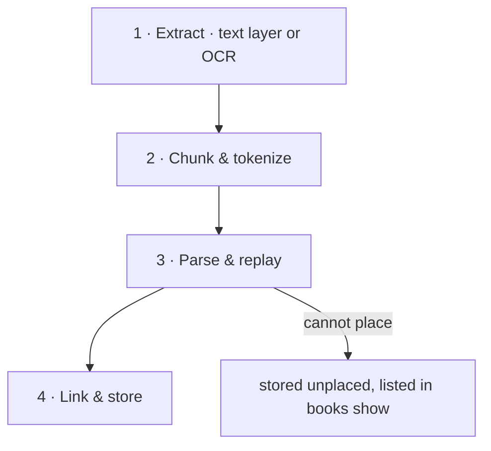

# Indexing pipeline

`chessinfo index <file>` turns a book into rows in `quotes` and `quote_positions` (see the [data model](architecture.md#data-model)). Each stage saves its output per chunk, so an interrupted run resumes where it stopped. A book is identified by the SHA-256 of its file, so re-indexing an unchanged book does nothing.



The guiding rule: **the pipeline is deterministic** ([D16](architecture.md#technical-decisions)). No LLM and no decision model takes part. Every move comes from the tokenizer, is placed by the game score parser, and is replayed with a chess rules library before it is stored. Nothing is thrown away: a chunk the parser cannot place is stored without position links, with the reason.

## 1. Extract

- **ePUB:** read the spine in order and convert the XHTML to text blocks. A block's chapter is the deepest entry of the navigation document (or the EPUB 2 NCX) reached so far. Printed page numbers come from page-break markers when the book has them. Title, author and language come from the OPF metadata. DRM-protected books are rejected.
- **PDF:** take the text layer with line positions (`pdftotext -bbox-layout`), in Poppler's reading order, so two-column pages are read column by column. Remove running headers and footers (top and bottom rows repeated across pages, or equal to the book or a chapter title), and read printed page numbers from them. Start a paragraph at a first-line indent or a wider vertical gap; a paragraph continues across columns and pages. Join hyphenated words and fix ligatures. Chapters come from the PDF outline (`pdftohtml -xml`); without one, chapters are unknown and a warning is printed.
- **OCR (M4, planned):** every PDF is also read by our own OCR, by default ([D17](architecture.md#technical-decisions)). Many PDFs found online carry a text layer from some other, imprecise OCR, so the existing text layer is not trusted on its own.
  - Pages are rendered with Poppler's `pdftoppm` and recognized in parallel by an OCR-specific local model, never an LLM. A CTC recognizer reads each character from the image, so it cannot write a fluent, plausible move the way a generative model can; its mistakes are character-level, which the [OCR-tolerant tokenizer](#ocr-scanned-books) already handles.
  - The recognizer returns words with boxes, which go through the same layout code as the text layer: headers and footers, columns, paragraphs, hyphenation.
  - When a page has a text layer too, the reading that replays more numbered moves is kept for that page. Scanned PDFs without a text layer are accepted.
  - `--no-ocr` keeps the text layer only. ePUBs are not affected.
  - The engine is chosen by the M4 spike and then fine-tuned on synthetic chess pages (see [milestones](milestones.md#m4-ocr)).
- `--title`, `--author` and `--language` override the detected metadata.

## 2. Chunk & tokenize

**Chunking.** Split the text into paragraph-sized chunks that never cross a chapter boundary, and keep the chapter and page with each chunk. Blocks under 200 characters (a move set apart on its own line, a caption) and headings are merged with the blocks that follow them, until the group reaches 200 characters. A heading equal to the chapter title is dropped. A chunk longer than 6,000 characters (about 1,500 tokens) is split between sentences.

**Notation convention.** Detect it once per book, from these candidates:

| Convention | King | Queen | Rook | Bishop | Knight |
|---|---|---|---|---|---|
| English | K | Q | R | B | N |
| Portuguese | R | D | T | B | C |
| Spanish | R | D | T | A | C |
| German | K | D | T | L | S |
| French | R | D | T | F | C |
| Figurine | ♔ ♚ | ♕ ♛ | ♖ ♜ | ♗ ♝ | ♘ ♞ |

The letters overlap: `R` means rook in English but king in Portuguese, Spanish and French. For that reason, detection (`gamescore.Detect`) parses the whole book under each candidate convention, with the [game score parser](#game-score-parser), and keeps the one that replays the most numbered moves. Figurines mean the same in every convention.

**Learned glyphs.** OCR and chess fonts leave piece glyphs of their own (`lll`, `.i`, `_`), which differ from book to book. A move whose glyph is unknown can still replay when only one legal move fits, and those moves show what the glyph means. A glyph is learned once at least 5 of its moves replayed and at least 90% of them were the same piece. U+FFFD, which OCR leaves for several pieces, never agrees enough and stays unknown. Every learned glyph settles moves that were ambiguous, which teaches more, so learning repeats until nothing new is learned (at most 5 rounds). Learned glyphs never override a convention's letters, so learning runs on top of every candidate, plus one with no letters at all, and the candidate that replays the most after learning wins.

For an OCR-scanned book, the winning convention is the letter set that replays best, not necessarily the book's language: a stray `A` that is really a bishop is enough to make Spanish win. The convention and the learned glyphs are stored per book in `books.notation`, and can be overridden with `--notation`. Descriptive notation (`P-K4`) is planned for M7.

**Tokenizing.** Find move candidates (`23.Nf5!`, `23...gxf5`, `O-O`, `exd8=Q+`) and give each an ID:

```
Text:   23.Nf5! A move that changes everything. 23...gxf5 (23...Qd7 24.Nh6+ Kh8 25.Qg4 and Black is lost) 24.Qg3+ Kh8 25.Qh4 The point: h7 cannot be defended.

Tokens: [m1 23.Nf5!] A move that changes everything. [m2 23...gxf5] ([m3 23...Qd7] [m4 24.Nh6+] [m5 Kh8] [m6 25.Qg4] and Black is lost) [m7 24.Qg3+] [m8 Kh8] [m9 25.Qh4] The point: [m10 h7] cannot be defended.
```

A token is a move *candidate*, not necessarily a move. A square named in prose (`h7` above, "a knight on d5") looks exactly like a pawn move, so it becomes a token too. Replay rejects most of them, and M5 tells the rest apart from moves by their context (`on d5`, `the d5 square`). Ranges and files (`a1-h8`, `c-file`) never become tokens.

Chunks are tokenized independently, so this stage runs in parallel.

The tokenizer is not tied to a convention: it accepts the piece letters of every convention and keeps them as printed, so detection can tokenize once and try each candidate. It records the printed move number and side. An unnumbered token right after a numbered white move is black's reply (`23.Nf5 b4`); any other unnumbered token gets its side from replay.

Move numbers may also be printed without a period (`24 axb4`) and with a spaced ellipsis (`25 ... Qb6`, `20 . . . Nxe5`).

<a id="ocr-scanned-books"></a>**OCR-scanned books.** Most chess books found online are scans whose text layer came from OCR, which garbles exactly the move text: piece glyphs come out as `lll`, `:i!`, `'tt>` or U+FFFD, move numbers are split (`2 1 .`), digits are read as letters (`dS` for d5, `l 8` for 18), and spaces appear inside moves (`e 5`, `lll x e5`). The tokenizer's OCR mode accepts these forms. It keeps each token's text and offsets verbatim and leaves the move itself, as printed, to replay. A move that only the OCR grammar accepts is kept only in move context, with a move number or next to another move, so that "on d5" is not read as a move by a piece called "on".

## 3. Parse & replay

<a id="game-score-parser"></a>**Game score parser.** The deterministic parser (`internal/gamescore`) follows games through the tokens of the book, across chunks, and builds each game's variation tree without any model. It is the parse step for every chunk, and the base for detecting a book's piece notation. A game runs across chunks, so each chunk starts from the position where the previous one ended: parsing runs in order within a game.

- A numbered white move 1 starts a game from the initial position. Games that start from a diagram need M7.
- A token's depth is the number of parentheses or brackets open before it. A move continues the line being read at its depth, and leaving a variation ends the deeper lines.
- A numbered move is played where its number is due on that line, or else on the main line. An unnumbered move continues the line.
- A move outside parentheses outranks one inside: books often give a variation before the main move it replaces, so the main move is promoted to the main line when it comes later.
- **Lookahead.** A numbered move that fits 2 to 4 legal moves opens a lookahead: every candidate becomes a tentative branch, and the following moves are played on each. A branch dies when a numbered move cannot be placed on it. The last branch standing wins; when the window of 8 numbered moves closes, a branch wins only with at least 2 more moves played than the next. Otherwise the move stays ambiguous, with its candidates, and the game stops: a guess would put a move in the index that the text does not support. A numbered move that no branch can place, or a move outside the variation that holds the ambiguity, closes the lookahead early.

**Replay.**

- A printed move is matched against the legal moves of the position, and must match exactly one. Check and mate marks are ignored, because books do not always get them right; an unneeded disambiguation (`Ngf3`) is accepted; a capture mark must agree with the move, which also rejects prose squares that happen to be legal pawn moves. A piece that could not be read (a chess font glyph extracted as U+FFFD) matches any piece but a pawn, and is accepted when only one legal move fits.
- An OCR'd move is matched the same way, character by character against each legal move: the destination file must be exact and the rank may be a look-alike (`l`, `I`, `i`, `|` for 1, `S` for 5, `B` for 8); the text before it is a piece glyph followed by an optional disambiguation; a glyph never ends with a file letter, so `Rad1` is a rook from the a-file. A glyph with a known meaning must be that piece, and a reading through a known glyph beats one through an unknown glyph. A move that fits several legal moves is not guessed: it is reported as ambiguous with its candidates.
- The move numbers printed in the tokens must agree with the computed ply. A mismatch means the structure is wrong.

**What the parser cannot place.** Some books write variations as sentences ("Instead of 12.O-O-O, 12.O-O Rd8 was also good"), which neither parentheses nor move numbers mark. A chunk whose moves cannot be placed is stored *unplaced*, with the reason, and `chessinfo books show <id>` lists it. Later chunks of the same game continue from the last good position until the move numbers stop lining up or a new game starts. M5 measures how many chunks end up unplaced per book; that number decides whether an [LLM fallback](#deferred-model-stages) is ever needed.

## 4. Link & store

A quote is a whole chunk ([D18](architecture.md#technical-decisions)). It is linked to every position its moves reach, using the move tree: positions on the main line and positions inside variations are told apart, with the ply from the chunk's first move and, for a variation, its line. The exact link types and the changes to the data model and the API are designed in M5 and recorded in [architecture.md](architecture.md).

- A chunk without moves is stored without position links. Linking prose to the position it discusses is left to *quote boundaries* (backlog).
- A chunk is not always about every position it reaches, and it may talk about one it does not reach. Narrowing a quote down to the sentences about one position is the one place a decision model may help later (backlog).
- Each chunk is written in a single transaction, together with its stage update.

## Hardware

OCR runs locally, on CPU or on a GPU when the engine supports one, and must fit an 8 GB GPU. Rendering and recognition run page by page in parallel. Real throughput is measured in the M4 spike and recorded here.

## Deferred model stages

Triage with a System One decision model and parsing with a generative LLM were designed for M4 and dropped from the pipeline ([D16](architecture.md#technical-decisions)) after the measurements below. The clients built in M3 remain, as the starting point for a fallback if M5 shows the parser leaves a real gap: `internal/llm` (Ollama `/api/chat` with a JSON schema), `internal/systemone` (Ollama `/v1/systemone`), and `chessinfo doctor --models`. The earlier design is in the git history of this file (merge `6287d90`).

### Measurements

**Laya on CPU** (M3 spike, 2026-11-01). Ollama 0.40.13 on an AMD Ryzen 5 7520U (4 cores, 8 threads), plugged in, `performance` governor. Passages are from the `classics` fixture; every request sends the three triage questions (`kind`, `discusses_previous`, `instructive`) unless noted. Warm figures are over 20 requests with the model loaded; cold includes loading it.

| Model | Passage | Input tokens | Cold | Warm median | Warm p95 |
|---|---|---|---|---|---|
| `laya` | one paragraph | 357 | 6.1 s | 3.2 s | 4.3 s |
| `laya` | 140 words | 945 | 15.1 s | 8.7 s | 14.3 s |
| `laya` | 140 words, `discusses_previous` only | 303 | 3.2 s | 2.7 s | 2.7 s |
| `laya:322m-multilingual-bf16` | one paragraph | 356 | 3.0 s | 1.3 s | 1.3 s |
| `laya:322m-multilingual-bf16` | 140 words | 962 | 5.4 s | 3.8 s | 5.1 s |
| `laya:322m-multilingual-bf16` | 140 words, `discusses_previous` only | 310 | 4.1 s | 1.3 s | 2.0 s |

- `ollama pull laya` works on Ollama 0.40.13, and `/v1/systemone` speaks the wire format of `internal/systemone`. The multilingual model is a tag of `laya`, not a model of its own.
- Each question is a separate forward pass over the state, and each pass must fit the window on its own. Ollama loads `laya` with a 512-token window (about 220 words of chess text with the `kind` question) and the multilingual tag with 8,192, although it was trained on 1,024. A state that does not fit is rejected with HTTP 400, never truncated.
- On this CPU a question costs about 1–3 s for `laya`, well above the published 0.2–0.5 s, and time grows with the state: every question reads the whole state again. The multilingual tag is 2–2.5× faster, more than its size explains.
- `input_tokens` in the response is the sum over the questions.

**Zero-shot triage on the fixture** (2026-11-01, same machine). The 19 chunks of the `classics` fixture, labeled by hand, plus its 3 game scores without comments, labeled `game_score`. Every model got the triage questions, with `previous` set to the last 60 words of the chunk before, and `true`/`false` descriptions for `discusses_previous`. A first look: 22 passages, one wording of the questions, labels by one person.

| Model | Runtime | `kind` correct | What it answers | `discusses_previous` at 0.5 | Warm median per request |
|---|---|---|---|---|---|
| `laya` | Ollama | 4/22 | `game_score` for 18 of 22 | 12/21 | 12.4 s |
| `laya:322m-multilingual-bf16` | Ollama | 5/22 | mostly `game_score`, some `other` | 10/21 | 5.6 s |
| [`bekko-system-one-v0-400m`](https://huggingface.co/hotchpotch/bekko-system-one-v0-400m) | Python, PyTorch 2.10 CPU, FP32 | 11/22 | `annotation` for 20 of 22 | 11/21 | 13.9 s |

- All three give nearly the same `kind` whatever the passage. Bekko's higher count only reflects that half the passages are annotations.
- `discusses_previous` agrees with the labels about as often as a constant answer would. `instructive` does not separate the passages either: Bekko rates the preface and game introductions above the annotations.
- Bekko does not batch any faster on CPU (22 requests in one call: 15 s each) and takes about 4 GB of RAM. It has no license yet, and it needs Python and PyTorch, so it would need a server of its own speaking `/v1/systemone`.
- Its model card reports far better results than Laya on its author's benchmark (S1MB task average 50.6 against 13.4), but these passages do not show it.

None of the three could skip a chunk safely on this evidence, and none answers in under a second on CPU. Larger decision models (OpenJev 27B, Open-Jev 2B and 9B, Nimble 9B) were considered: the 27B does not fit an 8 GB GPU, and the others are untested.

**Not measured** (needs an 8 GB GPU, and only matters if the fallback is built): Laya latency on GPU, and whether `qwen3.5:9b` runs 100% on the GPU at `num_ctx` 8192 (`chessinfo doctor --load` reports it).

## Evaluation

Each fixture lives in `backend/tests/assets/<name>/`:

- `book.md` is written for this project: original commentary on public-domain games (game scores are facts, not copyrighted text).
- `book.epub` and `book.pdf` are generated from `book.md` with `make fixtures`. A test fails when they are out of date.
- `expected.json` is the ground truth: for each expected quote, a distinctive substring and the position keys it must be linked to.

`chessinfo eval <fixture>` indexes the fixture into a scratch database and reports:

- position-link precision and recall
- the chunks the parser could not place
- time per stage

Books you own go in `backend/tests/assets/private/`, which is git-ignored. Never commit them. `make test-books` extracts, tokenizes and replays each of them and reports numbers only: tokens found, the share of numbered moves that replay, and how far each game replays. Minimums per book are kept in `backend/tests/books/thresholds.json` and raised as the pipeline improves; a book without an entry is measured but never fails. With M4, it also compares our OCR with each PDF's text layer by the share of numbered moves that replay.

## References

- [Laya model card](https://huggingface.co/convaiinnovations/laya)
- [Ollama System One API](https://docs.ollama.com/api/systemone)
- [Independent review of Laya's strengths and limits](https://andrew.ooo/posts/laya-review-open-weight-jev-alternative-system-1-decision-model/)
