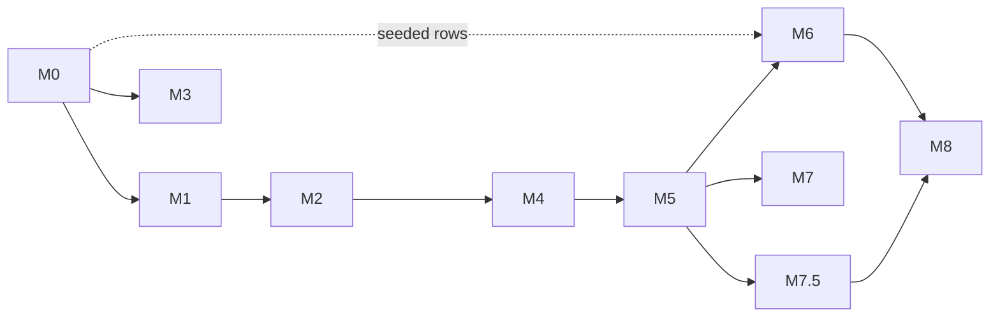

# Milestones

Each milestone has a goal, a checklist, and a **done when** test. Items are planned and approved one at a time (see [CLAUDE.md](../CLAUDE.md)).

The pipeline is deterministic ([D16](architecture.md#technical-decisions)): OCR comes first (M4), then the indexing pipeline (M5). M3 built the model clients, which the pipeline no longer uses; they stay for a possible fallback. M6 can start right after M0 by using seeded rows. M7 is not required for the first release.

## Current state

- [x] cobra CLI skeleton (`chessinfo --version`)
- [x] Next.js app with a board, a move list, undo, and a zustand chess store
- [x] Placeholder quotes panel and a stub `/api/v1/quotes` route
- [x] PostgreSQL via docker compose

## M0: Project foundations

Goal: anyone can clone, run and test the repository.

- [x] Root `.gitignore`, including `data/` (the Postgres volume) and built binaries
- [x] MIT license at the repository root
- [x] Makefile targets: `db-up`, `migrate`, `build`, `test`, `lint`, `dev`
- [x] `internal/config`, where flags override environment variables, which override defaults
- [x] Initial schema migration and `chessinfo migrate`
- [x] CI: `go vet`, `go test`, `biome check`, `next build`
- [x] Approve or amend the decisions in [architecture.md](architecture.md#technical-decisions)

**Done when:** on a fresh clone, `make db-up migrate test` passes and CI is green.

## M1: Book ingestion (no AI)

Goal: a book becomes ordered chunks, each with its chapter and page, stored in the database.

- [x] ePUB extractor: spine order, chapters, metadata
- [x] PDF extractor: text layer, header/footer removal, de-hyphenation; scanned PDFs are rejected
- [x] Chunker that keeps chapter and page
- [x] Book identity by SHA-256; `chessinfo index <file> --dry-run`
- [x] `chessinfo books list | show | remove`
- [x] First fixture: `book.md`, with `book.epub` and `book.pdf` generated from it

**Done when:** both fixture formats produce the same chunk sequence (page numbers aside), and indexing the same file twice does nothing.

## M2: Chess notation engine (deterministic)

Goal: turn move text into verified positions without any model, including OCR-scanned books, which are most of the chess books available online.

- [x] Move tokenizer: SAN, move numbers, `...`, black moves without a number (`23.Nf5 b4`), castling, promotions, annotation glyphs (`! ? !? ?! !! ??`)
- [x] Position key in Go, plus the shared fixture `backend/tests/assets/position_keys.json`
- [x] Replay with a variation tree, including moves whose piece could not be read
- [x] Tests against the books in `backend/tests/assets/private/`, skipped when there are none: token counts, the share of numbered moves that replay, and the games replayed from move 1 to the end. They report numbers only, never book text
- [x] OCR-tolerant tokenizing and move matching: split move numbers and ellipses (`2 1 .`, `. . .`), digits read as letters in numbers and squares (`l` and `I` for 1, `S` for 5, `O` for 0), spaces inside a move (`e 5`), move numbers without a period (`24 axb4`), and unreadable piece glyphs before a square
- [x] Piece notation detected by replay: the conventions (English, Portuguese, Spanish, German, French, figurine) as candidates, plus a per-book mapping, learned by replay, for chess-font and OCR glyphs (`lll`, `:i!`, `'tt>`, U+FFFD)
- [x] Deterministic parser for bare game scores (the triage fast path), with lookahead over ambiguous moves

**Done when:** unit tests cover every convention, reference games replay to the expected FENs, the fixture's bare game scores parse without any model, and the private books, when present, reach the replay thresholds measured for them.

## M3: Local model providers

Goal: chessinfo can talk to both local models and verify the setup.

- [x] `llm.Provider` with an Ollama implementation: structured output, `num_ctx`, `keep_alive`, and a check that the model is pulled
- [x] `systemone` client for Ollama's `POST /v1/systemone`, with `keep_alive` to unload Laya after triage
- [x] `chessinfo doctor`; the model checks run with `--models`
- [x] Spike on CPU, with results recorded in [indexing.md](indexing.md#measurements): `ollama pull laya` on Ollama 0.40+, the `/v1/systemone` wire format, the multilingual tag, Laya latency on CPU, and a zero-shot triage comparison with Bekko System One

**Outcome:** the clients work against Ollama 0.40.13, but the measurements showed that zero-shot triage is neither reliable nor fast enough, and the pipeline dropped the models ([D16](architecture.md#technical-decisions)). The GPU measurements moved to the backlog, with the LLM fallback that would need them.

## M4: OCR

Goal: every PDF, scanned or not, yields text that the notation engine reads well, using our own OCR by default ([D17](architecture.md#technical-decisions)).

- [ ] Spike, with results recorded in [indexing.md](indexing.md): compare stock OCR engines with CTC recognizers (such as Tesseract's LSTM engine and PaddleOCR) on scanned pages of public-domain chess books and on the private books. Measure the share of numbered moves that replay against the PDF's own text layer, pages per minute on CPU (and on GPU when available), and memory. Pick the engine
- [ ] Page rendering with Poppler `pdftoppm`, in parallel
- [ ] `ocr` package: the engine behind an interface, returning words with boxes, which feed the existing PDF layout code (headers and footers, columns, paragraphs, hyphenation)
- [ ] Per page, keep the reading that replays more numbered moves: our OCR or the text layer. PDFs without a text layer are accepted
- [ ] On by default for PDFs; `--no-ocr` keeps the text layer only. ePUBs are not affected
- [ ] `chessinfo doctor` checks the OCR engine and its model
- [ ] Synthetic training pages: `make fixtures` renders public-domain games with project-authored commentary in chess fonts, figurines included, with scan-like noise, so every page has exact ground truth
- [ ] Fine-tune the recognizer on the synthetic pages, and measure it against the stock model: character error rate on held-out synthetic pages, and the share of numbered moves that replay on real scans

**Done when:**

- The fixture PDF, rendered as images without a text layer, gives the same chunks and replays the same moves as the ePUB.
- On each private PDF, the share of numbered moves that replay is at least that of its text layer.
- The time per page meets the target set by the spike, on CPU.

## M5: Deterministic indexing pipeline

Goal: a whole book goes in, and position-linked quotes come out, without any model.

- [ ] Stage runner with per-chunk state, resume and progress output
- [ ] Tokenize chunks in parallel; parse and replay in order within each game, across chunks, with the game score parser
- [ ] Moves told apart from squares named in prose, by replay and by context (`on d5`, `the d5 square`)
- [ ] Chunks the parser cannot place are stored without links, with the reason, and listed in `chessinfo books show`
- [ ] Link and store: each chunk is a quote, linked to the positions its moves reach. The link types, data model and API changes are designed here and recorded in [architecture.md](architecture.md)
- [ ] Flags: `--notation`, `--title`, `--author`, `--language`, `--no-ocr`
- [ ] `chessinfo eval <fixture>`
- [ ] Measure the gap: the share of chunks with moves that the parser could not place, per book, reported by `make test-books`. It decides whether the LLM fallback in the backlog is needed

**Done when:**

- The fixture indexes end to end without any model.
- `chessinfo eval` reports position-link precision ≥ 0.9 and recall ≥ 0.7. These are initial targets, to be revisited after the first measurement.
- Killing `chessinfo index` and running it again resumes without creating duplicates.

## M6: Quotes in the web app

Goal: the panel shows what the books say about the position on the board.

- [ ] `src/modules/quotes` skeleton with the [hexagonal layout](architecture.md#web-app)
- [ ] Domain: `Quote` and `PositionKey`; position key tested against the shared fixture (`bun test`)
- [ ] Application: `FindQuotesByPosition` use case and `QuoteRepository` port, tested with an in-memory repository
- [ ] Infrastructure: `DATABASE_URL`, a read-only database role, a postgres.js `QuoteRepository`, `server-only` guards
- [ ] `/api/v1/quotes` as a thin inbound adapter following the [API contract](architecture.md#api), as revised in M5
- [ ] Panel: quote content with book, chapter and page; the main variation and analysis lines with move numbers and annotations, highlighting the current ply on `main` and `analysis` matches; loading, empty and error states
- [ ] Paging with `nextCursor`
- [ ] Clicking a move in the notation list jumps to that position
- [ ] Request quotes only once the position settles, and ignore stale responses

**Done when:**

- Playing into a fixture position shows its quotes as `exact` matches.
- Following a fixture game past a quoted position shows that quote as a `main` match with the right `ply`.
- A position inside a fixture variation shows its quote as an `analysis` match with the right `line` and `ply`.
- A transposition finds the same quotes.
- The API answers in under 100 ms (p95) locally on an indexed book.

## M7: Harder sources

Goal: handle the content that plain text extraction misses.

- [ ] Chess-font diagrams (grids of text glyphs) → FEN
- [ ] Image diagrams → FEN with a local board recognizer (not an LLM), validated for legality and piece counts, and stored as `diagram` quotes with an `exact` link
- [ ] Descriptive notation (`P-K4`), resolved against the legal moves
- [ ] More conventions: Italian, Dutch, Russian
- [ ] Chapters from running headers when a PDF has no outline
- [ ] Drop diagram noise (coordinate letters, glyph grids) before chunking

## M7.5: Game identification

Goal: recognize which known game a book is annotating, and use it to check and complete what the pipeline parsed.

- [ ] Look up candidate games by position in the Lichess masters explorer, with the game header (players, year) as a tie-breaker
- [ ] Confirm a match by replaying the reference game against the parsed mainline
- [ ] Store the game reference with the book's games, and show it in the web app
- [ ] Use a confirmed game to fill gaps, such as moves the book skips or chunks that failed to parse
- [ ] Opt-in (`--identify-games`), cached and rate-limited; indexing must work offline without it

Open questions: the explorer's current rate limits and authentication rules, and the `games` table this needs.

**Done when:** the three fixture games are identified, and indexing without network access gives the same quotes as before.

## M8: Release

Goal: a new user gets from zero to quotes on the board by following only the README.

- [ ] Cross-platform binaries (goreleaser)
- [ ] Full-stack docker compose (Postgres + web app)
- [ ] User guide: install, first index, troubleshooting OCR
- [ ] CONTRIBUTING, CHANGELOG, versioning

## Backlog (unscheduled)

- Export an indexed book as annotated PGN
- Semantic search over quotes (pgvector + a small embedding model)
- Theme tags (opening, strategy, tactics, endgame) with filters in the UI
- Quote boundaries: narrow a chunk quote down to the sentences about each position, and link prose without moves to the position it discusses. The one place a decision model may help; see the [triage measurements](indexing.md#measurements)
- LLM fallback for chunks the parser cannot place, planned only once M5 measures the gap. `internal/llm` and `internal/ollama` from M3 are its starting point; an OpenAI-compatible provider (LM Studio, llama.cpp server) could follow
- GPU measurements from the M3 spike, needed only with the two items above: Laya latency on GPU, and whether `qwen3.5:9b` runs 100% on an 8 GB GPU at `num_ctx` 8192 (`chessinfo doctor --load`)
- Opening names (ECO) on positions
