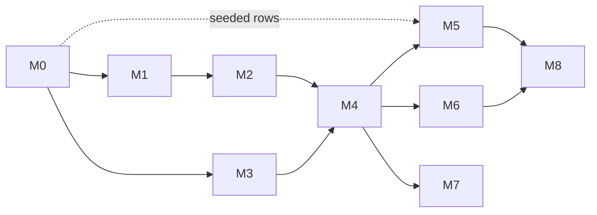

# Milestones

Each milestone has a goal, a checklist, and a **done when** test. Items are planned and approved one at a time (see [CLAUDE.md](../CLAUDE.md)).

M5 can start right after M0 by using seeded rows. M7 is not required for the first release.

## Current state

- [x] cobra CLI skeleton (`chessinfo --version`)
- [x] Next.js app with a board, a move list, undo, and a zustand chess store
- [x] Placeholder quotes panel and a stub `/api/v1/quotes` route
- [x] PostgreSQL via docker compose

## M0: Project foundations

Goal: anyone can clone, run and test the repository.

- [x] Root `.gitignore`, including `data/` (the Postgres volume) and built binaries
- [x] MIT license at the repository root
- [x] Makefile targets: `db-up`, `migrate`, `build`, `test`, `lint`, `dev`
- [x] `internal/config`, where flags override environment variables, which override defaults
- [x] Initial schema migration and `chessinfo migrate`
- [x] CI: `go vet`, `go test`, `biome check`, `next build`
- [x] Approve or amend the decisions in [architecture.md](architecture.md#technical-decisions)

**Done when:** on a fresh clone, `make db-up migrate test` passes and CI is green.

## M1: Book ingestion (no AI)

Goal: a book becomes ordered chunks, each with its chapter and page, stored in the database.

- [x] ePUB extractor: spine order, chapters, metadata
- [x] PDF extractor: text layer, header/footer removal, de-hyphenation; scanned PDFs are rejected
- [ ] Chunker that keeps chapter and page
- [ ] Book identity by SHA-256; `chessinfo index <file> --dry-run`
- [ ] `chessinfo books list | show | remove`
- [x] First fixture: `book.md`, with `book.epub` and `book.pdf` generated from it

**Done when:** both fixture formats produce the same chunk sequence (page numbers aside), and indexing the same file twice does nothing.

## M2: Chess notation engine (deterministic)

Goal: turn move text into verified positions without any model.

- [ ] Move tokenizer: SAN, move numbers, `...`, castling, promotions, annotation glyphs (`! ? !? ?! !! ??`)
- [ ] Notation conventions (English, Portuguese, Spanish, German, French, figurine), detected by replay
- [ ] Chess fonts without Unicode figurines: some PDFs extract piece glyphs as U+FFFD or stray characters such as `@` or `"1`. Map them per font (font names from `pdftohtml -xml`) to piece letters, and confirm the mapping by replay
- [ ] Replay with a variation tree
- [ ] Position key in Go, plus the shared fixture `backend/tests/assets/position_keys.json`
- [ ] Deterministic parser for bare game scores (the triage fast path)

**Done when:** unit tests cover every convention, reference games replay to the expected FENs, and the fixture's bare game scores parse without any model.

## M3: Local model providers

Goal: chessinfo can talk to both local models and verify the setup.

- [ ] `llm.Provider` with an Ollama implementation: structured output, `num_ctx`, `keep_alive`, and a check that the model is pulled
- [ ] `systemone` client for Ollama's `POST /v1/systemone`, with `keep_alive` to unload Laya after triage
- [ ] `chessinfo doctor`
- [ ] Spike, with results recorded in [indexing.md](indexing.md#models-and-the-8-gb-vram-budget):
  - confirm `ollama pull laya` on Ollama 0.40+, that `/v1/systemone` is wire-compatible with the client, and whether `laya-multilingual` is in the Ollama library
  - measure Laya latency on CPU and on GPU
  - confirm `qwen3.5:9b` fits in 8 GB at `num_ctx` 8192; if it does not, switch the default to `qwen3.5:4b`

**Done when:** `chessinfo doctor` passes on an 8 GB GPU machine and the measurements are recorded.

## M4: Indexing pipeline MVP

Goal: a whole book goes in, and position-linked quotes come out.

- [ ] Stage runner with per-chunk state, resume and progress output
- [ ] Triage stage and routing (conservative τ)
- [ ] Parse stage: prompt, schema, output validation
- [ ] Replay and repair loop
- [ ] Link and store: quotes with a main variation and analysis lines, plus `exact`, `main` and `analysis` position links
- [ ] Flags: `--model`, `--no-triage`, `--notation`, `--title`, `--author`, `--language`
- [ ] `chessinfo eval <fixture>`

**Done when:**

- The fixture indexes end to end on an 8 GB GPU.
- `chessinfo eval` reports position-link precision ≥ 0.9 and recall ≥ 0.7. These are initial targets, to be revisited after the first measurement.
- Killing `chessinfo index` and running it again resumes without creating duplicates.

## M5: Quotes in the web app

Goal: the panel shows what the books say about the position on the board.

- [ ] `src/modules/quotes` skeleton with the [hexagonal layout](architecture.md#web-app)
- [ ] Domain: `Quote` and `PositionKey`; position key tested against the shared fixture (`bun test`)
- [ ] Application: `FindQuotesByPosition` use case and `QuoteRepository` port, tested with an in-memory repository
- [ ] Infrastructure: `DATABASE_URL`, a read-only database role, a postgres.js `QuoteRepository`, `server-only` guards
- [ ] `/api/v1/quotes` as a thin inbound adapter following the [API contract](architecture.md#api)
- [ ] Panel: quote content with book, chapter and page; the main variation and analysis lines with move numbers and annotations, highlighting the current ply on `main` and `analysis` matches; loading, empty and error states
- [ ] Paging with `nextCursor`
- [ ] Clicking a move in the notation list jumps to that position
- [ ] Request quotes only once the position settles, and ignore stale responses

**Done when:**

- Playing into a fixture position shows its quotes as `exact` matches.
- Following a fixture game past a quoted position shows that quote as a `main` match with the right `ply`.
- A position inside a fixture variation shows its quote as an `analysis` match with the right `line` and `ply`.
- A transposition finds the same quotes.
- The API answers in under 100 ms (p95) locally on an indexed book.

## M6: Triage quality (Laya)

Goal: find out from data how much Laya saves, and use it only where it is reliable.

- [ ] Label the fixture chunks (`kind`, `discusses_previous`, `instructive`). Start from LLM-generated labels and review them by hand.
- [ ] Measure zero-shot Laya against the labels and fit a threshold τ per question
- [ ] Decide from the results which skips are safe
- [ ] Optional: fine-tune Laya on LLM-teacher labels (distillation) and load the checkpoint from config
- [ ] Tune `relevancy` (derived from `instructive`) so the most useful quotes come first

**Done when:** triage cuts LLM calls by at least 30% while losing at most 2% of the expected quotes in `chessinfo eval`. If Laya cannot reach that, triage stays opt-in and the result is documented.

## M7: Harder sources

Goal: handle the content that plain text extraction misses.

- [ ] Chess-font diagrams (grids of text glyphs) → FEN
- [ ] Image diagrams → FEN with the vision model, validated for legality and piece counts, and stored as `diagram` quotes with an `exact` link
- [ ] Descriptive notation (`P-K4`), resolved against the legal moves
- [ ] More conventions: Italian, Dutch, Russian
- [ ] Scanned PDFs via OCR (stretch goal)

## M8: Release

Goal: a new user gets from zero to quotes on the board by following only the README.

- [ ] Cross-platform binaries (goreleaser)
- [ ] Full-stack docker compose (Postgres + web app)
- [ ] User guide: install, first index, troubleshooting VRAM
- [ ] CONTRIBUTING, CHANGELOG, versioning

## Backlog (unscheduled)

- Export an indexed book as annotated PGN
- Semantic search over quotes (pgvector + a small embedding model)
- Theme tags (opening, strategy, tactics, endgame) with filters in the UI
- An OpenAI-compatible provider (LM Studio, llama.cpp server)
- Opening names (ECO) on positions
